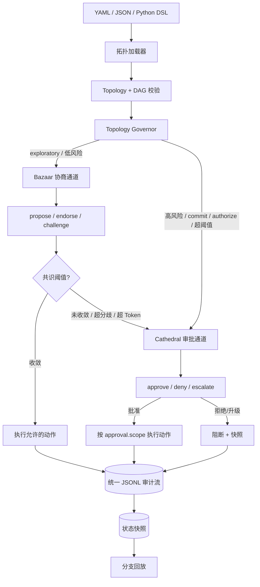
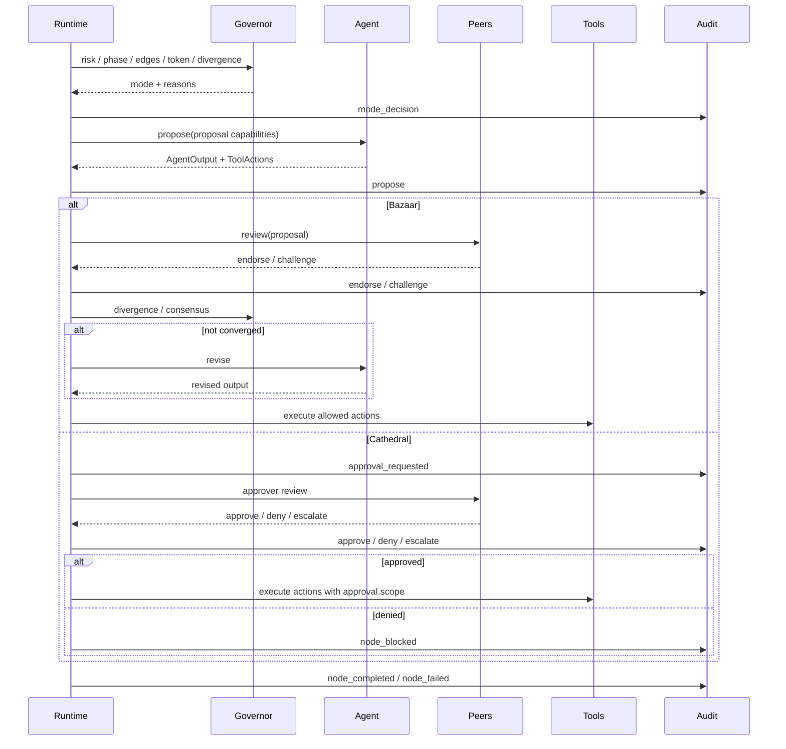
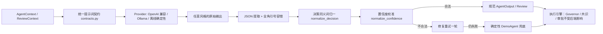

# Narthex 架构

## 1. 总览



## 2. 模块职责

| 模块 | 职责 |
| --- | --- |
| `models.py` | 拓扑、节点、Agent、边、Governor 配置的数据模型与 DAG 校验 |
| `topology/yaml_lite.py` | 无第三方依赖的安全 YAML 子集解析 |
| `topology/loader.py` | YAML / JSON / Python DSL 统一加载 |
| `governance/governor.py` | 固定优先级的治理模式决策 |
| `governance/consensus.py` | 可替换的共识与分歧度量 |
| `llm/provider.py` | 模型无关 Provider 抽象（OpenAI 兼容 / 离线确定性 / 缓存） |
| `llm/contracts.py` | 统一提示词契约与响应解析 |
| `llm/normalize.py` | 决策同义词归一、置信度校准、健壮 JSON 提取 |
| `llm/agent.py` | `LLMAgent`：修复重试、确定性兜底、模型无关 Token 计量 |
| `capabilities.py` | Cathedral / Bazaar 的能力收窄规则 |
| `runtime/agents.py` | Agent 协议、函数适配器、确定性演示 Agent |
| `runtime/tools.py` | 工具注册、能力检查、副作用执行 |
| `runtime/approval.py` | 审批 Provider 接口与自动/录制实现 |
| `runtime/engine.py` | 节点执行、Bazaar 循环、Cathedral 门禁、模式切换 |
| `runtime/snapshot.py` | 快照序列化、分支元数据 |
| `runtime/state.py` | 可序列化运行状态与结果 |
| `audit.py` | 哈希链审计流与完整性校验 |

## 3. Governor 决策顺序

Governor 使用固定顺序，避免“显式配置覆盖安全策略”：

1. `phase in commit_phases` -> Cathedral
2. 存在入站 `authorize` 边 -> Cathedral
3. `risk` 命中 `high_risk_tags` -> Cathedral
4. 节点显式 `mode: cathedral` -> Cathedral
5. 累计 Token 超过预算 -> Cathedral
6. 分歧度超过阈值 -> Cathedral
7. Bazaar 未收敛 -> Cathedral 仲裁
8. 探索标签或显式 `mode: bazaar` -> Bazaar
9. 其他情况 -> 拓扑默认模式

因此，一个节点即使声明 `mode: bazaar`，只要处于 `commit` 阶段或带有 `risk:high`，仍会被强制切换到 Cathedral，并产生 `policy_override` 审计事件。

## 4. 节点生命周期



## 5. Bazaar 共识循环

Bazaar 不是“无限自由聊天”。它使用有限轮次和局部规则：

```text
for round in 1..max_rounds:
    对每条 consult 入边，源 Agent 评审当前提案
    当前 Agent 反向评审上游产物
    endorse_ratio = 认可数 / 评审数
    divergence = max pairwise Jaccard distance
    if divergence > threshold: 切换到 Cathedral 仲裁
    if endorse_ratio >= consensus_threshold: 收敛
    否则 revise
轮次耗尽仍未收敛 -> Cathedral 仲裁
收敛后若动作需要 execute 能力 -> 冻结到 Cathedral 审批门，批准前不执行
```

`consult` 在治理语义上是双向的，但在执行依赖上仍是有向边，用于确定稳定的拓扑顺序。

## 6. Cathedral 审批

Cathedral 节点先生成提案，再进入审批门：

1. 生成阶段只拥有提案类能力，不能写入。
2. 审批前写入快照，确保拒绝后可以从该点回放。
3. 每个 `approvers` 与 `ApprovalProvider` 都返回 `approve / deny / escalate`。
4. 任一否决或升级即阻断。
5. 批准后，能力集收窄为 `declared capabilities ∩ approval.scope`；省略 scope 时只保留提案侧能力。
6. `ToolInvoker` 在真正执行时再次校验能力。

## 7. 统一审计流

所有 Cathedral 与 Bazaar 事件写入同一个 `audit.jsonl`。每条事件：

```json
{
  "seq": 42,
  "timestamp": "2026-10-18T06:00:00.000Z",
  "run_id": "narthex-...",
  "kind": "approve",
  "node_id": "production_change",
  "agent_id": "release_manager",
  "mode": "cathedral",
  "payload": {"decision": "approve", "rationale": "..."},
  "prev_hash": "...",
  "hash": "..."
}
```

哈希计算覆盖除 `hash` 外的所有字段，包括 `prev_hash`。`verify` 会逐条重算并验证链。

## 8. 快照与回放

快照保存：

- 拓扑完整定义
- 任务文本
- 已完成节点结果
- 当前累计 Token、最大分歧度、最后模式
- 分支与父运行 ID
- 从当前节点开始的剩余执行计划

回放流程：


## 9. 扩展到真实 Agent

实现以下接口即可接入任意 LLM/SDK：

```python
class MyAgent:
    spec: AgentSpec

    def propose(self, context: AgentContext) -> AgentOutput:
        ...

    def review(self, context: ReviewContext) -> Review:
        ...

    def revise(self, context, output, reviews) -> AgentOutput:
        ...
```

`AgentContext` 提供：

- 当前节点、Agent 规格、任务、治理模式
- 当前有效能力集
- 能力受限的 `ToolInvoker`
- 上游节点结果视图
- 当前协商轮次

### 跨大模型一致性（LLM 适配层）

`build_llm_registry(topology)` 会把拓扑内全部 Agent 包装为 `LLMAgent`，其一致性策略如下：



关键不变量：

1. **治理语义不变**：无论后端如何措辞，`normalize_decision` 只产出 `endorse / challenge / approve / deny / escalate` 五个规范决策；解析失败时 Bazaar 落到 `challenge`、Cathedral 落到 `escalate`（只收紧、不放宽权限）。
2. **预算口径不变**：`LLMAgent` 忽略厂商 usage 上报，始终用 `estimate_tokens(content)` 计入 Governor 的 `token_budget`。
3. **共识口径不变**：分歧度使用 Jaccard 距离，与模型风格无关。
4. **运行不中断**：契约破坏先修复重试，仍失败回退确定性 Agent；工具副作用仍受能力边界与审批门约束。
5. **效率稳定**：`CachedProvider` 对相同提示词去重（回放/重跑零成本、结果确定），`OpenAICompatProvider` 对 429/5xx 自动退避重试。

## 10. 安全边界

- YAML 解析器不执行任意标签；Python DSL 会执行代码，只加载可信文件。
- 工具写入只允许写入当前运行的 `artifacts/` 目录，文件名经过路径清理。
- 审计哈希链检测篡改，但不提供身份认证；生产环境应增加签名。
- 能力边界是运行时逻辑边界，不是操作系统级沙箱；高风险场景应将工具执行放到独立进程/容器并叠加系统权限控制。
